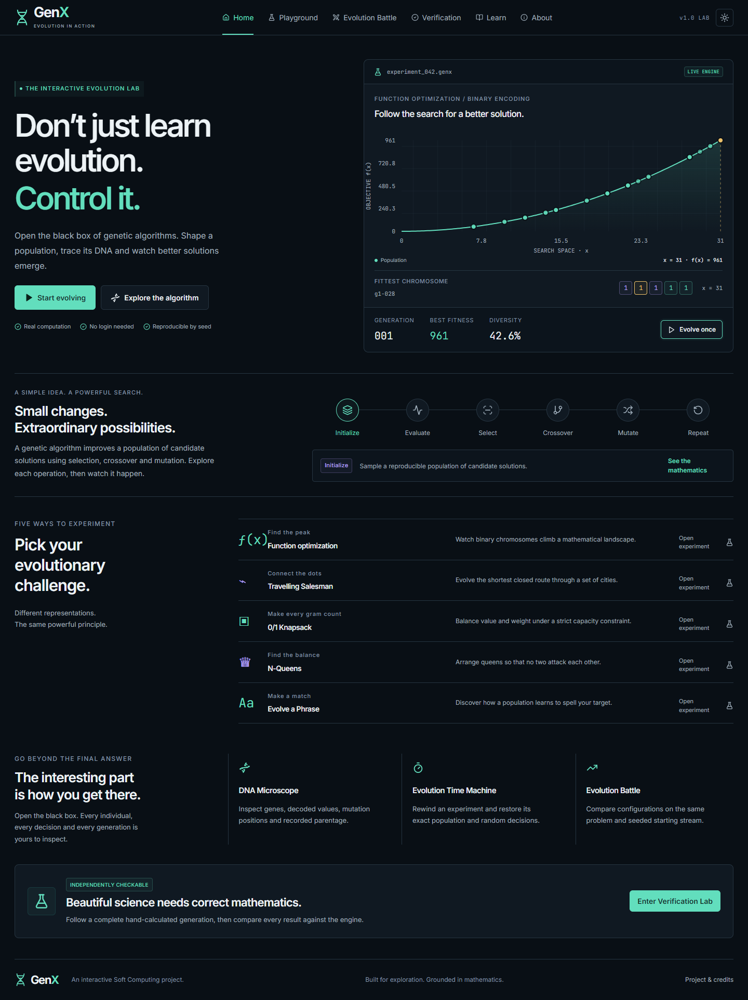
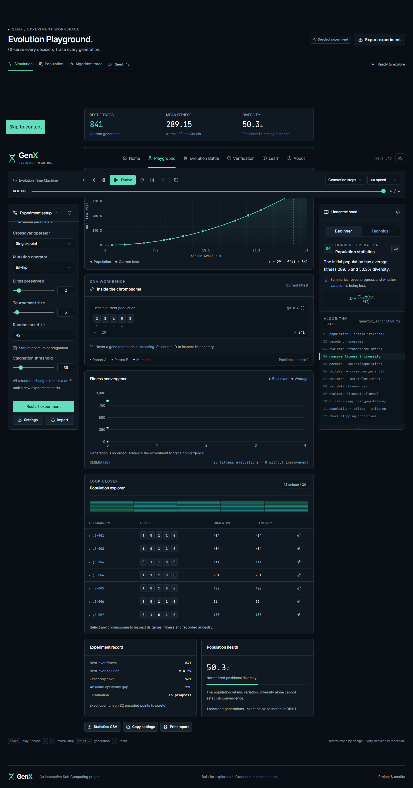
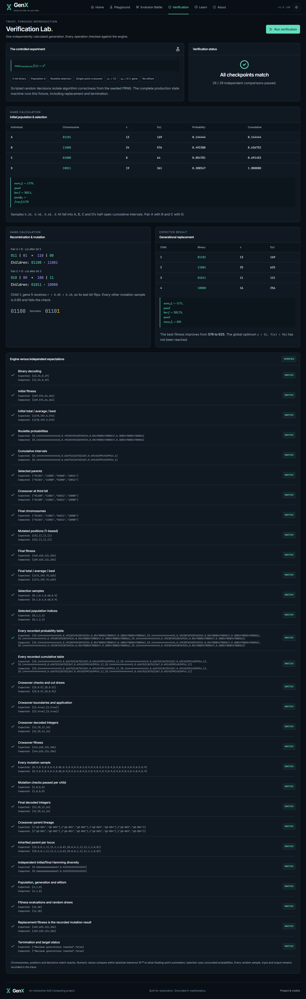

# GenX — Evolution in Action

**Don't just learn evolution. Control it.**

A browser-only genetic algorithm laboratory for a university Soft Computing project. GenX makes selection, crossover, mutation, replacement and convergence inspectable through deterministic events, real computations and an independently calculated numerical example.

## Abstract & problem statement

Genetic algorithms are often taught as pseudocode followed by a final fitness curve. That hides the decisions that connect a genotype to an improved population. GenX exposes those decisions through reversible micro-steps, mathematical explanations and problem-specific visualizations. Its objective is to teach both what an operator does and why its representation, probabilities and constraints matter.

The application works without authentication, a backend, database, API key or paid service. After downloading its static assets, simulation computation stays in the browser.

## Mathematical audit

The complete findings, corrections, probability semantics and independent oracle checks are documented in [docs/mathematical-audit.md](docs/mathematical-audit.md). Run `npm run audit:verification` for the 29-checkpoint hand-calculated example and its full JSON trace. Actual executed results are recorded in [VALIDATION.md](VALIDATION.md).

## Features

- Home, Evolution Playground, Evolution Battle, Verification Lab, Learn and About.
- Five genuine optimization environments: binary functions, TSP, 0/1 knapsack, N-Queens and phrase evolution.
- Configurable population, generation limit, probabilities, operators, elitism, tournament size, seed and early stopping.
- Draft settings require an explicit new experiment; historical states never silently adopt changed parameters.
- Play/pause, previous/next micro-step, previous/next generation, reset confirmation, beginning/latest navigation, timeline scrubbing, speed and execution granularity.
- Sticky desktop playback toolbar, compact mobile playback with expandable settings, and keyboard shortcuts outside form fields.
- Simulation-first mobile workspace with collapsible setup and separate Simulation, Population and Algorithm trace views.
- DNA Workbench with animated, recorded parent/offspring chromosomes, crossover boundaries and exact mutation highlights.
- Actual event traces with chromosomes, fitness, parent IDs, selection indices, random samples, crossover boundaries and changed mutation positions.
- Beginner/technical explanations, KaTeX equations and highlighted pseudocode.
- DNA Microscope, gene meanings, fitness ranking, historical individuals and a two-level recorded ancestry graph.
- SVG objective landscape, editable city map, chessboard, knapsack meter, phrase matches and a Canvas gene-variation heatmap.
- Recharts fitness convergence and comparison by generation or evaluation count.
- Independent Held–Karp TSP solver (≤10 cities), integer knapsack dynamic programming, exhaustive encoded-function optima and a separate queen validity checker.
- Exact normalized positional Hamming diversity, unique counts, stagnation and evidence-based warnings.
- Shared-seed synchronized battles with independently configurable mutation, selection, population, elites and crossover probability.
- Manual crossover, explicit gene flips and a computed prediction challenge in Learn.
- Configuration import/export, results plus event-trace JSON, generation-statistics CSV, copy settings and print-friendly reports.
- Light/dark themes, responsive layouts, keyboard focus, reduced-motion support and locally editable team credits.

## Actual application screenshots

Captured by the browser tests from the running application:







Mobile captures are in `docs/screenshots/` alongside the desktop captures.

## Quick start

Use **Node.js 22.12 or later** (tested locally with Node 22.13.1) and npm.

```sh
npm install
npm run dev
```

Open the Local URL printed by Vite, normally `http://127.0.0.1:5173`. Vite chooses another port if that one is occupied. Use the application through its server URL, not by double-clicking `index.html`.

```sh
npm run build       # strict TypeScript + optimized static output in dist/
npm run preview     # serve the production build locally
npm run typecheck
npm run lint
npm run test        # non-interactive Vitest suite
npm run test:watch
```

For browser tests:

```sh
npx playwright install chromium
npm run test:e2e
```

Playwright starts Vite automatically unless `GENX_BASE_URL` is set. `PLAYWRIGHT_CHANNEL=chrome` can use an installed Chrome instead of a downloaded browser. See [testing](docs/testing.md) for the local execution record and environment-specific commands.

## A presentation-ready path

1. Open Playground. The default task maximizes `x²` over the 32 integers 0–31.
2. Select **Next step** to see recorded selection decisions; switch explanations to Technical.
3. Select **Next generation**, then rewind. The genes and random decisions restore exactly.
4. Inspect an individual and its recorded ancestry.
5. Open Verification and run the independent numerical fixture.
6. Compare low and high mutation in Evolution Battle. Discuss one-run limitations.

The [four-minute demo script](docs/demo-script.md) provides a timed walkthrough.

### Keyboard shortcuts

| Shortcut      | Action                       |
| ------------- | ---------------------------- |
| Space         | Play / pause                 |
| Right         | Next micro-step              |
| Left          | Previous micro-step          |
| Shift + Right | Complete the next generation |
| R             | Request reset                |

Shortcuts do not run while typing in inputs, textareas, selects or editable content. Native button keyboard behavior is preserved. Playback timers are canceled on pause, configuration restart and unmount.

## Technology & architecture

React 19, strict TypeScript, Vite 7, Tailwind CSS 4, Motion, Recharts, Lucide React, KaTeX, Vitest, Playwright and ESLint. React hooks own experiment state; no extra state library is required. `package-lock.json` records the actual compatible installed versions.

```text
src/
  app/                     hash-routed application shell
  components/              panels, fields, formulas, charts and error boundary
  engine/
    types.ts               typed genes, configurations, problems and events
    random.ts              Mulberry32, scripted sources and seeded shuffle
    operators.ts           selection, crossover, mutation, diversity
    simulation.ts          lazy event-driven state machine
    verification.ts        independent expected values + scripted engine fixture
  problems/                extensible problem factory, validation, exact solvers
  hooks/useExperiment.ts   playback cursor, producer, recording and timer cleanup
  visualizations/          SVG problem views and Canvas heatmap
  features/
    playground/            configuration, playback, explanations and lab
    ancestry/              microscope and bounded recorded family tree
    comparison/            synchronized experiment battle
  pages/                   home, verification, learn/manual lab and about
  tests/                   engine and mathematical correctness tests
  utils/                   exports
e2e/                       desktop and mobile browser tests
docs/                      formulas, hand calculation, testing, demo and captures
```

The engine has no React or DOM dependency. `Simulation.run()` is a lazy generator. Its events share population arrays until replacement; all genetic operators copy genomes. Only new events consume random samples. Rewinding changes a display cursor, so forward replay returns the already-recorded events.

Function evaluation is eager when an offspring output is constructed so even intermediate chromosomes have inspectable fitness. The evaluation counter includes both pre-mutation preview evaluations and post-mutation offspring evaluations, including any excess child discarded for odd population sizes. Elite copies reuse evaluated fitness. Independent exact-solver work and chart landscape sampling are excluded from this counter.

Results exports use schema version 2: `individuals` stores each recorded object version, `populations` stores arrays of individual indices, and each event references those tables with zero-based indices in `population`, `inputs`, `outputs`, `bestEver` and nullable `bestFeasible`. This preserves pre/post-mutation versions without repeatedly serializing entire populations. The top-level summary and statistics remain directly readable. Knapsack gaps use the best feasible candidate, or null if no feasible solution is recorded. Print reports include active settings and generation statistics.

## Genetic algorithm pseudocode

```text
P ← initialize(seed)
decode and evaluate P
record population statistics
while generation limit not reached:
    if early stopping enabled and (known target or stagnation reached): stop
    O ← empty offspring pool
    E ← copy best elitism_count individuals
    while |O| < population_size − |E|:
        select two parents, recording each random decision
        apply compatible crossover if r < crossover_probability
        record provisional offspring and their fitness
        apply compatible mutation with recorded probability checks
        validate offspring; record their fitness
        add only as many children as the replacement pool requires
    P ← E + O
    update best-ever and best-feasible records
    record immutable generation replacement and statistics
record termination reason
```

See [algorithm.md](docs/algorithm.md) for precise probability semantics and formulas.

## Supported problems

| Problem  | Encoding               | Selection fitness                                                  | Independent reference                  |
| -------- | ---------------------- | ------------------------------------------------------------------ | -------------------------------------- |
| Function | Binary, 3–10 bits      | Direct square/multimodal; transformed minimum; shifted signed sine | Exhaustive search of encoded points    |
| TSP      | Permutation            | `1/(1 + closed-tour distance)`                                     | Held–Karp, ≤10 cities                  |
| Knapsack | Binary inclusion       | Value if within capacity, otherwise 0                              | Integer dynamic programming            |
| N-Queens | Unique row permutation | `N(N−1)/2 − attacking diagonal pairs`                              | Separate row/diagonal validity checker |
| Phrase   | Unicode code points    | Correct characters in correct positions                            | Exact target                           |

The TSP map supports click-to-add, drag-to-move and double-click-to-remove in edit mode, plus seeded-random and circle presets. Finish editing and create a new experiment to apply an instance. Knapsack names, weights, values and capacity are editable. The phrase alphabet explicitly includes every target code point; unsupported control characters are rejected.

## Independent verification

Initial chromosomes `01101, 11000, 01000, 10011` decode to `13, 24, 8, 19`, with fitness `169, 576, 64, 361` and total `1170`.

Scripted roulette samples `0.10, 0.40, 0.68, 0.90` select A, B, C, D. Cut after the third bit in both pairs. Only gene 5 of child 1 mutates (`0.05 < 0.1`; every other mutation sample is `0.90`). The resulting population is:

| Child | Binary |   x |  x² |
| ----- | ------ | --: | --: |
| 1     | 01101  |  13 | 169 |
| 2     | 11001  |  25 | 625 |
| 3     | 01011  |  11 | 121 |
| 4     | 10000  |  16 | 256 |

Final total: **1171**. Average: **292.75**. Best: **625**, improved from **576**. The global optimum **961** at **31** remains unreached. The UI compares **29 checkpoints**, including all random draws and intermediate outputs, against independently written expectations. [Complete hand calculation](docs/verification.md).

## Deployment

The output is a static application. Relative asset URLs (`base: './'`) and hash routing support both domain-root and repository-subpath hosting. No server-side URL rewrite is needed.

### Vercel

Create a Vercel project from your repository, select the Vite framework, and set the root directory to the folder containing this `package.json`. Build command: `npm run build`. Output: `dist`. `vercel.json` includes these settings.

### Netlify

Import the repository, set the correct base directory if GenX is nested, build with `npm run build`, and publish `dist`. `netlify.toml` contains the build settings. Alternatively, build locally and upload `dist` through the Netlify interface.

### GitHub Pages

After creating your own public repository and uploading this project:

1. Open repository Settings → Pages and choose **GitHub Actions** as the source.
2. Run the included **Deploy GitHub Pages (manual)** workflow from Actions.
3. Use the deployment URL returned by GitHub. Routes look like `…/your-repository/#playground`.

The included CI workflow runs lint, type checking, unit tests, production build and browser tests on pushes and pull requests. The separate Pages workflow runs only when manually dispatched. No repository, remote URL, account deployment or publishing action has been fabricated or performed by this delivery.

## Academic references

Conceptual research and inspiration only; no source code or branding was copied.

- [Cornell Computational Optimization Open Textbook: Genetic algorithm](https://optimization.cbe.cornell.edu/index.php?title=Genetic_algorithm)
- [TU Delft MUDE: Genetic Algorithm](https://mude.citg.tudelft.nl/book/2025/optimization/genetic_algorithm.html)
- [IIT Bombay: Genetic Algorithms, Prof. Tom V. Mathew](https://www.civil.iitb.ac.in/tvm/nptel/703_GAs.html)
- [VisuAlgo](https://visualgo.net/en/)
- [Alaa Khamis: Genetic Algorithm Lab](https://optimization-algorithms-book.github.io/Code-Listings/Chapter%208/GA_Lab.html)
- [Genetic Algorithm Visualization](https://ifbars.github.io/genetic-algorithm-visualization/)
- [daviswest/tsp-ga-visualizer](https://github.com/daviswest/tsp-ga-visualizer) (user-supplied reference; source retrieval was unavailable during implementation)

## Team credits

Replace these before submission, or enter credits on About:

| Member          | Role   | Roll number   |
| --------------- | ------ | ------------- |
| [Team member 1] | [Role] | [Roll number] |
| [Team member 2] | [Role] | [Roll number] |
| [Team member 3] | [Role] | [Roll number] |

Course: Soft Computing. Institution / department / supervisor: **[Fill in]**. Submission date: **24 November 2026**.

## Limits & future scope

- 4–100 individuals; 1–200 generations; population × generation budget ≤6,000 to bound recorded history. Generation computation is bounded and playback yields between generations; no worker is needed at these limits.
- TSP: 3–20 cities, exact reference only at ≤10. Knapsack: 2–20 items, positive integer weights, capacity ≤500. Queens: 4–16. Phrase: 1–40 printable Unicode code points.
- Function results refer to the finite encoded grid, not exact continuous optima. There is no custom expression parser or `eval`.
- Positional Hamming diversity is used and explicitly labeled for permutations; it is not TSP edge diversity and can count rotated equivalent routes as different.
- Timelines exist in memory while the laboratory is open. Navigating away or reloading starts a new timeline. Export results before leaving; only settings, theme and credits persist locally. Configuration imports start fresh experiments; recorded-results replay import is not implemented.
- Ancestry expands by selecting a recorded ancestor; each view displays at most two ancestral generations. Historical forks, PMX and multi-seed statistics are omitted. Single-seed battles do not establish universal superiority.
- Locally bundled Inter Variable and JetBrains Mono provide consistent, offline-friendly typography. No external image/font service is required.
- Automated Chromium device emulation is not a substitute for testing physical phones, other browser engines or assistive technologies. CI workflows are supplied but have not been run on a remote GitHub repository.

Future work: checkpoint-based long-run replay, historical forks, worker execution, multi-seed confidence intervals, TSP edge metrics and a screen-reader-focused trace viewer.
